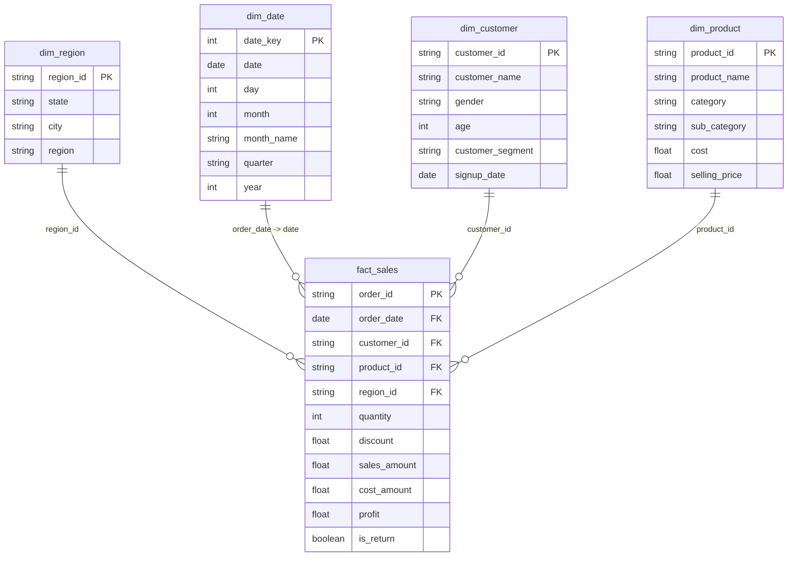

# Vibe Analysis — E-Commerce Sales & Profit Analytics

End-to-end data analytics project on 25,050 raw e-commerce transactions, using **Gemini** to perform data profiling, data cleaning, star-schema modeling, business analysis, and to build an interactive **HTML** dashboard.

[dashboard.png]


> **Live Interactive Dashboard:** Open [`dashboard.html`](dashboard.html) in any browser, or view it live at `https://shivanshu-sharma1376.github.io/Vibe-Analysis-Ecommerce/dashboard.html` (once GitHub Pages is enabled).

---

## Overview

The goal is to demonstrate an AI-assisted ("Vibe Analysis") data workflow—going from messy raw CSVs to a validated star schema—and to answer practical business questions such as:

- Which products generate the highest revenue, and which high-revenue products suffer from thin profit margins?
- How do revenue, profit, and profit margins trend month-over-month across 2024–2025?
- Which product categories and regions drive the most profit?
- How do returns and heavy discounts affect overall profitability?

## Dataset

| Item | Detail |
|---|---|
| Raw files | 4 CSVs (`orders_raw.csv`, `customers_raw.csv`, `products_raw.csv`, `regions_raw.csv`) |
| Raw rows | 25,050 orders, 2,010 customers, 100 products, 20 regions |
| Clean star schema | 24,895 orders (`fact_sales`), 2,000 customers, 100 products, 20 regions, 731 dates |
| Time period | January 2024 – December 2025 |
| Data quality issues found | 60 exact duplicate rows (50 orders, 10 customers), 10 `'not_a_date'` order dates, 95 blank foreign keys (60 `customer_id`, 35 `product_id`), 15 negative-quantity return rows, 12 misformatted/mismatched product categories, and 12,562 orders dated before customer `signup_date` |

## Tools

- **Gemini**: data profiling, data-quality auditing, cleaning, star-schema modeling, and business analysis
- **HTML / JavaScript**: standalone interactive dashboard (`dashboard.html`) with dynamic filtering

## Steps

### 1. Data Profiling (Gemini)
- Inspected all four raw CSV files for row counts, grain, primary keys, foreign-key integrity, missing values, duplicates, and math/date anomalies
- Verified that `profit = sales_amount - cost_amount` held for normal orders, while 15 negative-quantity rows (`is_return`) had mismatched profit formulas
- Identified 571 positive-quantity orders with negative profit caused by `15%`–`20%` discounts

### 2. Data Cleaning & Star Schema Modeling (Gemini)
- **Customers (`dim_customer.csv`):** Removed 10 exact duplicate rows (2,010 → 2,000) and backdated 1,856 `signup_date` values to each customer's earliest valid order date (resolving all 12,562 pre-signup orders)
- **Products (`dim_product.csv`):** Trimmed whitespace and standardized casing (`8` raw labels → `5` canonical categories), and realigned 12 mismatched `category` rows to match their `sub_category`
- **Regions (`dim_region.csv`):** Validated uniqueness and state-to-region mapping across all 20 rows (`0` nulls, `0` duplicates)
- **Date (`dim_date.csv`):** Generated a 731-row calendar dimension (`2024-01-01` – `2025-12-31`) with `date_key`, `date`, `day`, `month`, `month_name`, `quarter`, and `year`
- **Fact Sales (`fact_sales.csv`):** Removed 50 exact duplicates, excluded 10 `'not_a_date'` rows, deleted 95 rows with blank `customer_id` or `product_id`, standardized `order_date` to `YYYY-MM-DD`, and flagged 15 negative-quantity rows with `is_return = True`



### 3. Dashboard (HTML)
Built a standalone interactive HTML dashboard (`dashboard.html`) with dropdown filters for **Year**, **Region**, **Category**, and **Returns** (`Include` / `Exclude`). It displays 4 KPI cards (Total Revenue, Total Profit, Total Orders, Unique Customers), Monthly Sales & Profit Trend, Revenue by Category, Profit by Region, and Top 10 Products by Revenue.

## Results

| Metric | Finding |
|---|---|
| Total net revenue | **29.36M** (`29,364,273.78`) |
| Total net profit | **6.73M** (`6,729,974.81`) |
| Overall profit margin | **22.92%** |
| Total orders & customers | **24,895** orders across **2,000** unique customers |
| Top category by revenue | **Clothing** (**7.23M**), followed by **Home & Kitchen** (**7.08M**) |
| Top region by profit | **North** (**1.71M**), closely followed by **East** (**1.69M**) and **South** (**1.69M**) |
| Lowest region by profit | **Central** (**0.32M**, 1 state) |
| Top product by revenue | **Kids Product 98** (`P0098`: **823.5K** revenue, **38.52%** margin) |
| Peak revenue month | **December 2025** (**1,320,182.05**) |
| Peak profit month | **August 2025** (**302,557.59** at **24.11%** margin) |
| High-revenue, low-margin SKUs | **24 products** earn above-average revenue (`>= 293.6K`) at below-average margins (`< 21.81%`), led by `Paper Product 24` (**7.90%**) and `Appliances Product 40` (**8.28%**) |

## Business Recommendations

- **Reprice or cap discounts on low-margin SKUs:** Review pricing and `15%`–`20%` discount rules on high-volume, thin-margin items like `Paper Product 24` (**7.90%**), `Appliances Product 40` (**8.28%**), and `Cookware Product 89` (**9.57%**).
- **Double down on top-performing categories:** Focus inventory and promotional spend on **Clothing** and **Home & Kitchen**, which drive nearly half of total revenue.
- **Investigate Central region coverage:** Central lags far behind other regions (**0.32M** profit) because it covers only one state; evaluate expansion opportunities.
- **Standardize return accounting:** Track `is_return = True` transactions separately so gross sales and net return-adjusted profit are reported consistently.

## Project Files

| File | What it is |
|---|---|
| `DATA/` | Raw CSV datasets (`orders_raw.csv`, `customers_raw.csv`, `products_raw.csv`, `regions_raw.csv`) |
| `CLEAN/` | Cleaned star-schema CSVs (`fact_sales.csv`, `dim_customer.csv`, `dim_product.csv`, `dim_region.csv`, `dim_date.csv`) |
| `dashboard.html` | Standalone interactive HTML dashboard |
| `dashboard.png` | Dashboard screenshot |

## How to Run

1. Clone the repo
   ```bash
     git clone https://github.com/Shivanshu-Sharma1376/Vibe-Analysis-Ecommerce.git
     cd Vibe-Analysis-Ecommerce 

2. Open `dashboard.html` directly in any web browser (no server or extra setup required) to explore all KPIs, charts, and filters.

## Author

**Shivanshu Sharma**

GitHub: [Shivanshu-Sharma1376](https://github.com/Shivanshu-Sharma1376)
