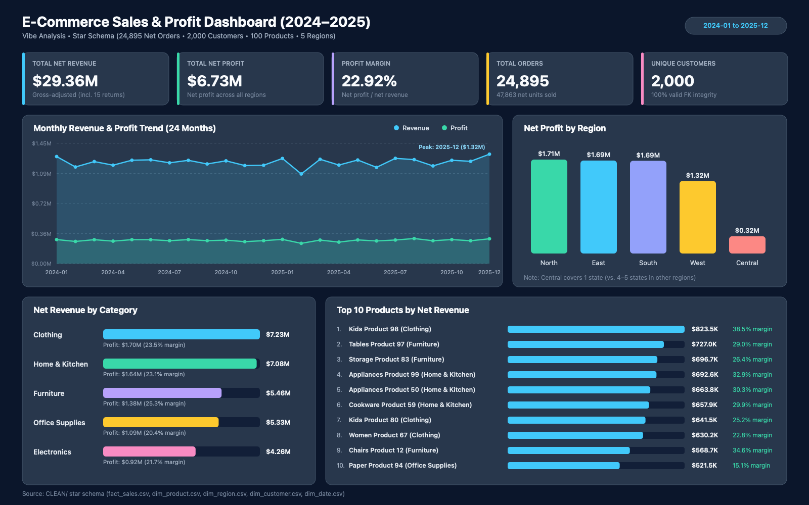

# Vibe Analysis — E-Commerce Sales & Profit Analytics

End-to-end data analytics project on 25,050 raw e-commerce transactions, using **Gemini** to perform data profiling, data cleaning, star-schema modeling, business analysis, and to build an interactive **HTML** dashboard.



> **Live Interactive Dashboard:** View the [Live Interactive Dashboard](https://shivanshu-sharma1376.github.io/Vibe-Analysis-Ecommerce/dashboard.html) or open `dashboard.html` locally in any browser.

## Overview

The goal is to demonstrate an AI-assisted ("Vibe Analysis") data workflow—going from messy raw CSVs to a validated star schema—and to answer practical business questions such as:

- Which products generate the highest revenue, and which high-revenue products suffer from thin profit margins?
- How do revenue, profit, and profit margins trend month-over-month across 2024–2025?
- Which product categories and regions drive the most profit?
- How do returns and heavy discounts affect overall profitability?

## Dataset

| Item | Detail |
|---|---|
| Raw files | 4 CSVs (`orders_raw.csv`, `customers_raw.csv`, `products_raw.csv`, `regions_raw.csv`) |
| Raw orders | 25,050 rows (cleaned to **24,895** net valid orders) |
| Customers | 2,000 unique customers across 4 segments |
| Products | 100 SKUs across 5 categories |
| Regions | 20 states grouped into 5 regions (North, East, South, West, Central) |
| Timeframe | January 1, 2024 – December 31, 2025 (731 dates) |

## Tools

- **Gemini**: data profiling, cleaning, star-schema design, business analysis, and dashboard generation
- **HTML / Chart.js**: standalone interactive dashboard (`dashboard.html`)

## Steps

### 1. Data Profiling & Cleaning
- Profiled all 4 raw CSVs for duplicates, invalid dates, orphan foreign keys, and category mismatches
- **`dim_customer.csv`** (2,000 rows): Removed 10 exact duplicate `customer_id` rows, standardized `signup_date` to `YYYY-MM-DD`, and backdated 1,856 signup dates to `min(signup_date, earliest_valid_order_date)` to resolve 12,562 pre-signup orders
- **`dim_product.csv`** (100 rows): Standardized `category` casing/whitespace (`8` raw variants → `5` canonical categories) and aligned 12 mismatched `category` rows to their `sub_category`
- **`dim_region.csv`** (20 rows): Verified 0 nulls and 0 duplicates across all 20 state/region records
- **`fact_sales.csv`** (24,895 rows): Removed 50 exact duplicates, quarantined 10 `'not_a_date'` rows, removed 95 rows with blank `customer_id` or `product_id`, standardized `order_date` to `YYYY-MM-DD`, and flagged 15 negative-quantity return rows with `is_return`
- **`dim_date.csv`** (731 rows): Generated calendar dimension from unique valid `order_date` values (`2024-01-01` – `2025-12-31`)

### 2. Star-Schema Validation & Business Analysis
Verified 0 nulls, 100% unique primary keys, and 0 orphan foreign keys across all 5 tables, then analyzed:
1. Overall net revenue, net profit, profit margin, order volume, and customer count
2. Month-over-month revenue and profit trends across 2024–2025
3. Net profit by region and net revenue by product category
4. Top 10 products by net revenue and margin efficiency

### 3. Dashboard (`dashboard.html` & `dashboard.png`)
Built a standalone interactive HTML dashboard with KPI cards, a 24-month trend chart, category and regional breakdowns, top products, and dynamic filters, plus a static `dashboard.png` preview.

## Results

| Metric | Finding |
|---|---|
| Total net revenue | **$29.36M** (`$29,364,273.78`, incl. 15 returns) |
| Total net profit | **$6.73M** (`$6,729,974.81`) |
| Overall profit margin | **22.92%** |
| Total orders & units | **24,895** orders (**47,863** net units sold) |
| Unique customers | **2,000** |
| Peak revenue month | **2025-12** (**$1.32M** revenue, **$299.5K** profit) |
| Peak profit month | **2025-08** (**$1.25M** revenue, **$302.6K** profit) |
| Top category by revenue | **Clothing** (**$7.23M**), followed by **Home & Kitchen** (**$7.08M**) |
| Top region by profit | **North** (**$1.71M**), closely followed by **East** (**$1.69M**) and **South** (**$1.69M**) |
| Top product by revenue | **Kids Product 98** (`Clothing` — **$823.5K** revenue, **38.52%** margin) |

## Business Recommendations

- **Reprice or cap discounts on low-margin SKUs:** Review pricing and `15%`–`20%` discount rules on high-volume, thin-margin items like `Paper Product 94` (**15.09%** margin).
- **Double down on top-performing categories:** Focus inventory and promotional spend on **Clothing** and **Home & Kitchen**, which drive nearly half of total revenue.
- **Investigate Central region coverage:** Central lags far behind other regions (**$0.32M** profit) because it covers only one state; evaluate expansion opportunities.
- **Standardize return accounting:** Track `is_return = True` transactions separately so gross sales and net return-adjusted profit are reported consistently.

## Project Files

| File | What it is |
|---|---|
| `DATA/` | Raw CSV datasets (`orders_raw.csv`, `customers_raw.csv`, `products_raw.csv`, `regions_raw.csv`) |
| `CLEAN/` | Cleaned star-schema CSVs (`fact_sales.csv`, `dim_customer.csv`, `dim_product.csv`, `dim_region.csv`, `dim_date.csv`) |
| `dashboard.html` | Standalone interactive HTML dashboard |
| `dashboard.png` | Dashboard screenshot |

## How to Run

1. Clone the repo
   ```bash
   git clone https://github.com/Shivanshu-Sharma1376/Vibe-Analysis-Ecommerce.git
   cd Vibe-Analysis-Ecommerce
   ```
2. Open `dashboard.html` directly in any web browser (no server or extra setup required) to explore all KPIs, charts, and filters.

## Author

**Shivanshu Sharma**

GitHub: [Shivanshu-Sharma1376](https://github.com/Shivanshu-Sharma1376)
